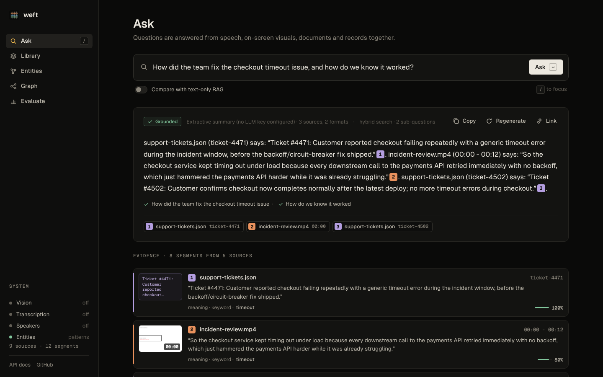
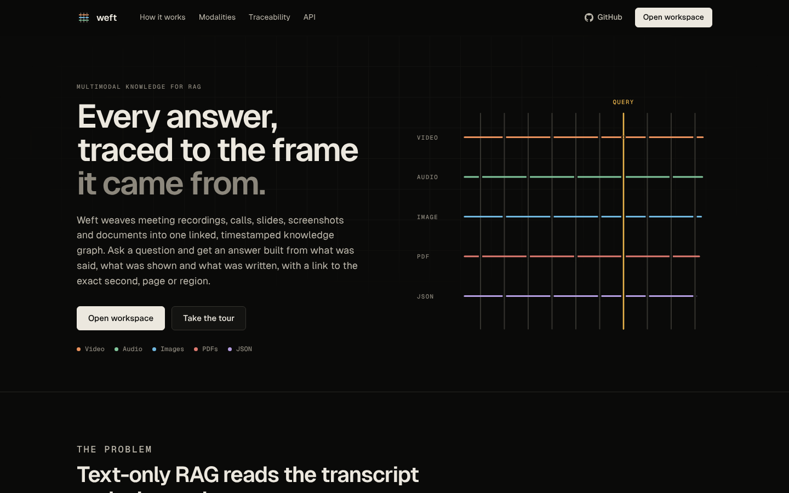
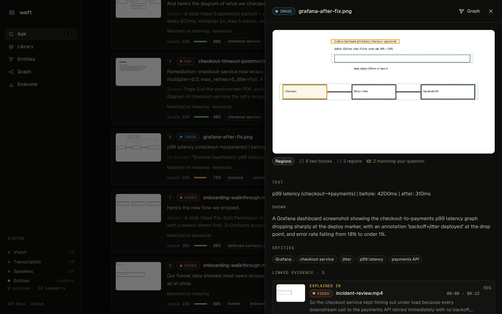
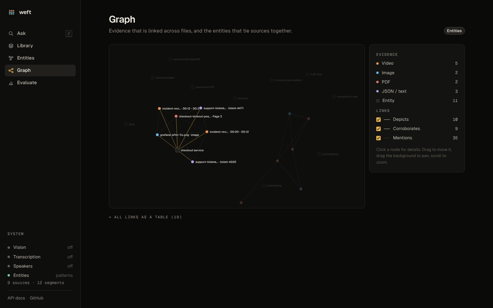
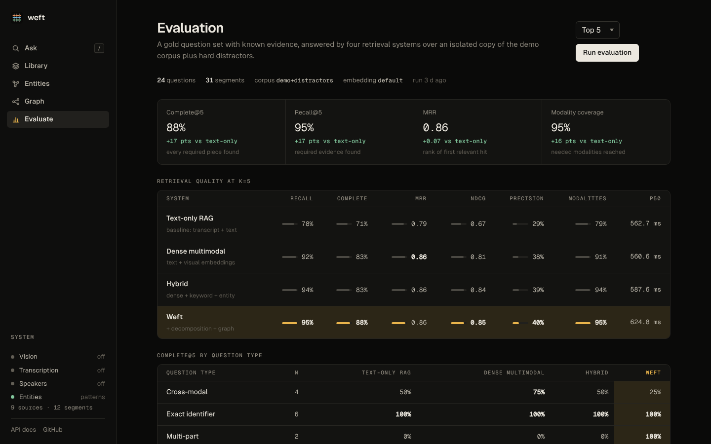
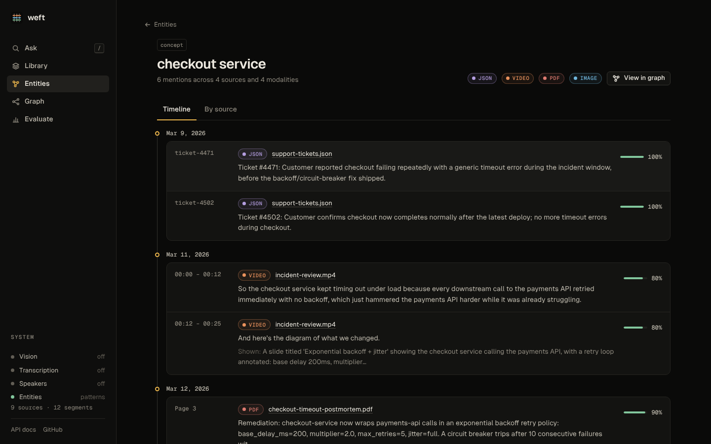
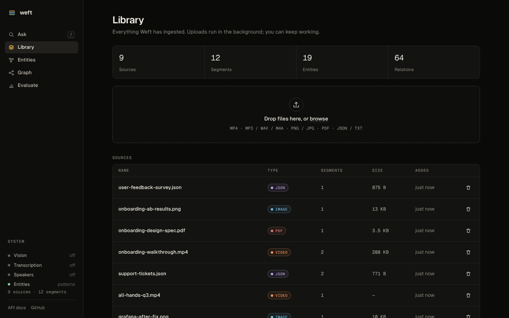

<h1> Weft</h1>

**Multimodal data pipeline for RAG.** Weft ingests video, audio, images, PDFs and JSON, keeps the exact location of every piece of evidence, links what was said to what was shown across files, and answers questions with citations you can open at the right second, page or region.

[](https://github.com/Priyansh10ff/Weft/actions/workflows/ci.yml)     

[Product](docs/PRODUCT.md) · [Requirements](docs/PRD.md) · [Technical reference](docs/TECHNICAL.md) · [Design system](docs/DESIGN.md) · [Evaluation report](EVALUATION.md)



---

## Contents

- [Why](#why)
- [Features](#features)
- [Screenshots](#screenshots)
- [Results](#results)
- [Quickstart](#quickstart)
- [Configuration](#configuration)
- [Using it](#using-it)
- [Architecture](#architecture)
- [Project layout](#project-layout)
- [Testing](#testing)
- [Security](#security)
- [Status and limitations](#status-and-limitations)
- [Documentation](#documentation)

## Why

Text-only RAG reads transcripts and document text. It never sees the slide on screen, the diagram on page 3 or the dashboard that proves a fix worked, and it cannot connect evidence that is split across a recording, a PDF and a screenshot. Weft treats every format as evidence, links it, and shows exactly where each answer came from.

## Features

**Ingestion**
- Video is cut into scenes where the picture changes, not fixed chunks. Each scene keeps the speech said over it (with timestamps and speakers) and a description of what was shown, with text blocks and regions located on the frame
- Audio is transcribed with timestamps and confidence (Groq Whisper, local faster-whisper fallback)
- PDFs become one segment per page: the exact text layer plus an analysis of the rendered page
- Images keep their OCR text and visual regions with bounding boxes
- JSON and text become one segment per record
- Background jobs with progress that resume after a restart, duplicate detection by content hash

**Knowledge model**
- Every segment records its location, the extractor that produced it and a confidence score
- Typed entities (people, systems, metrics, concepts) with name variants resolved to one entity
- Typed links across files and time: `depicts`, `corroborates`, `co_occurs`, `shows_same`, `same_as`, `next`, `spoken_by`, each with the reason it exists

**Retrieval and answers**
- Multi-part questions split into sub-questions, each guaranteed its best evidence
- Semantic, keyword (BM25 for exact identifiers like `max_retries=5`) and entity search, fused by rank
- Linked evidence in other formats ranked up, with the link that brought it in
- Every hit says why it was returned and where the match is: the sentence and its timestamp, or the region on the image
- Answers streamed from Gemini with numbered citations, or a short quoted summary when no key is configured

**Evaluation**
- 24 questions with known evidence plus look-alike decoy files
- Four systems compared on the same corpus, from text-only RAG to full Weft, per question type and per question

**Website**
- Workspace with Ask, Library, Entities, Graph and Evaluate, plus a four-step guided tour over the sample data
- Evidence drawer that opens a video at the cited second, a PDF at the page or an image with the matched region outlined

**Production**
- Docker image and compose file, GitHub Actions CI (tests on Python 3.10 and 3.12, Docker build and smoke test)
- Optional API key on every write, security headers and a strict Content Security Policy, upload signature checks, request IDs, structured errors
- Self-hosted fonts and no third-party requests from the website

## Screenshots

| | |
|---|---|
|  |  |
| **Landing page** | **Evidence:** the matched regions on a Grafana screenshot, its text, entities and the recording that explains it |
|  |  |
| **Graph:** evidence linked across files, here everything that mentions "checkout service" | **Evaluation:** four retrieval systems on the gold set |
|  |  |
| **Entity timeline:** one entity across JSON, video, PDF and image | **Library:** uploads, sources and background jobs |

Screenshots use the bundled sample data with no API keys configured, so the answer above is the extractive summary rather than a Gemini answer.

## Results

Gold set of 24 questions over the sample corpus plus hard distractors (31 segments), MiniLM embeddings, top 5.

| System | Recall@5 | Complete@5 | MRR | Modality coverage |
|---|---|---|---|---|
| Text-only RAG (baseline) | 78% | 71% | 0.79 | 79% |
| Dense, text + visual | 92% | 83% | 0.86 | 91% |
| Hybrid (dense + keyword + entity) | 94% | 83% | 0.86 | 94% |
| **Weft** (hybrid + decomposition + graph) | **95%** | **88%** | **0.86** | **95%** |

Complete@5 means every piece of required evidence was in the top 5. Weft reaches 100% on visual-only, exact-identifier and multi-part questions. Cross-modal questions are its weakest type at 25% (hybrid 50%). Full breakdown in [EVALUATION.md](EVALUATION.md) and [TECHNICAL.md §9](docs/TECHNICAL.md#9-evaluation-appevaluation). Small differences (about 0.02 MRR) appear between platforms because of the embedding runtime.

## Quickstart

### Docker

```bash
git clone https://github.com/Priyansh10ff/Weft.git
cd Weft
cp .env.example .env                   # optional: add API keys
docker compose up --build
```

Open [http://localhost:8000/app](http://localhost:8000/app). Data is kept in the `weft-data` volume.

### Python

Requires Python 3.10 or newer.

```bash
git clone https://github.com/Priyansh10ff/Weft.git
cd Weft
python -m venv .venv
source .venv/bin/activate              # Windows: .\.venv\Scripts\Activate.ps1
pip install -r requirements.txt
cp .env.example .env                   # Windows: copy .env.example .env
uvicorn main:app --reload
```

Open [http://127.0.0.1:8000/app](http://127.0.0.1:8000/app). The first start downloads the MiniLM embedding model (about 80 MB).

### First steps

1. Choose **Load sample data**, or **Take the tour** on the landing page.
2. Ask *How did the team fix the checkout timeout issue, and how do we know it worked?*
3. Click a citation to open the evidence at its exact location.
4. Open **Graph** and **Evaluate**.

## Configuration

Settings come from environment variables or `.env`. The API keys are optional: everything runs without them, with reduced features.

| Variable | Default | Purpose |
|---|---|---|
| `GEMINI_API_KEY` | | Vision for keyframes, images and PDF pages, typed entities, speaker labels, written answers. Without it: no visual descriptions, image uploads refused, pattern-based entities, extractive answers. [Get one](https://aistudio.google.com/apikey) |
| `GROQ_API_KEY` | | Fast Whisper transcription. Without it: local faster-whisper. [Get one](https://console.groq.com/keys) |
| `WEFT_API_KEY` | | Require this key on every upload, question, delete and evaluation run |
| `CORS_ORIGINS` | | Origins allowed to call the API from a browser. Empty means same origin only |
| `MEDIA_STORAGE_ROOT` | `./data` | Uploads, derived files, evaluation reports |
| `MAX_UPLOAD_MB` | `500` | Upload size limit |
| `ENABLE_DEMO` | `true` | Allow loading the sample data |
| `LOG_LEVEL` | `INFO` | Log level |

The workspace sidebar and `GET /health` show which providers are active. The full list, including the video segmentation and storage settings, is in [TECHNICAL.md §11](docs/TECHNICAL.md#11-configuration).

## Using it

**Website.** `/` is the landing page. `/app` is the workspace:

| Page | What it does |
|---|---|
| **Ask** | A question, the evidence as soon as it is found, the answer as it is written with citations, and an optional comparison with text-only RAG |
| **Library** | Upload files, follow their jobs, open a source to see its segments in order |
| **Entities** | Every named thing, and each one's mentions across files over time |
| **Graph** | The whole knowledge base as linked evidence and entities, or one node's neighbourhood |
| **Evaluate** | Run the gold set and inspect which evidence each system found or missed |

**API.** Upload a file, then ask:

```bash
curl -F "file=@incident-review.mp4" "http://127.0.0.1:8000/upload/video?background=true"
curl -X POST http://127.0.0.1:8000/query -H "Content-Type: application/json" \
     -d '{"query": "What retry policy replaced the old one, and where was it shown?", "limit": 5}'
```

Add `-H "X-API-Key: ..."` when the server has `WEFT_API_KEY` set. `POST /query/stream` returns the same answer as server-sent events. Interactive docs are at `/docs`, and the full endpoint list is in [TECHNICAL.md §10](docs/TECHNICAL.md#10-http-api).

**CLI.**

```bash
python -m app.evaluation run --k 5 --markdown EVALUATION.md   # evaluate and write the report
python -m app.cli stats                                       # counts by table, modality, relation
python -m app.cli reindex                                     # rebuild the vector index from SQLite
python -m app.cli relink                                      # recompute cross-modal links
```

## Architecture

```
upload ─► processor (video · audio · image · pdf · json) ─► speakers + entities
       ─► ingestion: SQLite (system of record) + Chroma (index) + FTS5 (keywords)
       ─► linker: co_occurs · shows_same · depicts · corroborates · same_as

question ─► decompose ─► dense + BM25 + entity ─► rank fusion ─► graph boost
         ─► confidence weighting + coverage ─► cited evidence ─► streamed answer
```

One FastAPI process serves the API, the website and the media, and runs the background jobs. SQLite holds every record. The Chroma index is keyed by segment ID and can be rebuilt from SQLite at any time. Details in [TECHNICAL.md](docs/TECHNICAL.md).

| Layer | Choice |
|---|---|
| API | Python, FastAPI, Uvicorn |
| Storage | SQLite (WAL, FTS5), ChromaDB with MiniLM-L6 embeddings |
| Models | Google Gemini (vision, entities, speakers, answers), Groq Whisper (transcription) |
| Media | OpenCV, PyMuPDF, pypdf, Pillow |
| Frontend | Plain HTML, CSS and ES modules, no build step |
| Packaging | Docker, docker compose, GitHub Actions |

## Project layout

```
main.py               FastAPI app, middleware and website routes
app/api/              HTTP routes and security middleware
app/services/         processors, pipeline, ingestion, linker, retrieval, answers
app/db/               SQLite repository
app/schemas/          records and API models
app/evaluation/       gold set, metrics, runner, CLI
static/               landing page and workspace (HTML, CSS, ES modules, fonts)
test_data/            sample corpus and loader
tests/                pytest suites
docs/                 product, requirements, technical and design docs, screenshots
Dockerfile            image; docker-compose.yml runs it with a data volume
.github/workflows/    CI: tests, Docker build and smoke test
```

## Testing

```bash
pip install -r requirements-dev.txt
pytest tests
```

The suite needs no network or API keys: Gemini and Groq are disabled and a deterministic embedding replaces MiniLM. It covers scene detection, every processor, the repository, uploads and jobs, linking, retrieval, the answer stream, the API, evaluation and the security middleware. GitHub Actions runs it on Python 3.10 and 3.12, then builds the Docker image, loads the sample data and asks a question.

## Security

- Set `WEFT_API_KEY` and every write (uploads, questions, deletes, evaluation runs) needs it as `X-API-Key` or `Authorization: Bearer`. The website asks for it once and keeps it in the browser. Reads stay open, so keep private data on a private network or behind your own auth.
- CORS is closed unless `CORS_ORIGINS` is set.
- Security headers and a strict Content Security Policy on the website, upload type, size and signature checks, request IDs and errors that never expose a stack trace are always on.
- Secrets come only from the environment. `/health` reports which providers are configured, never the keys.

Details in [TECHNICAL.md §12](docs/TECHNICAL.md#12-security-and-operations).

## Status and limitations

Version 0.3. Everything above is implemented and tested. Known limitations:

- Cross-modal questions are the weakest question type in the evaluation (25% complete at top 5, against 50% for hybrid).
- Visual evidence needs a Gemini key. Without it, image uploads are refused and slides and pages carry no description.
- The gold set is small and built on sample data, so the numbers may not transfer to other corpora.
- One process with SQLite: built for local or team use, not many concurrent users.

The roadmap and risks are in [PRD.md](docs/PRD.md#9-release-plan).

## Documentation

| Document | Covers |
|---|---|
| [PRODUCT.md](docs/PRODUCT.md) | What Weft is, why it exists, who it's for, how it works |
| [PRD.md](docs/PRD.md) | Goals, user stories, requirements, metrics, roadmap, risks |
| [TECHNICAL.md](docs/TECHNICAL.md) | Architecture, data model, pipeline, linking, retrieval, evaluation, API, configuration, security, operations |
| [DESIGN.md](docs/DESIGN.md) | Colour tokens, type, layout, components, states |
| [EVALUATION.md](EVALUATION.md) | The latest evaluation report |
